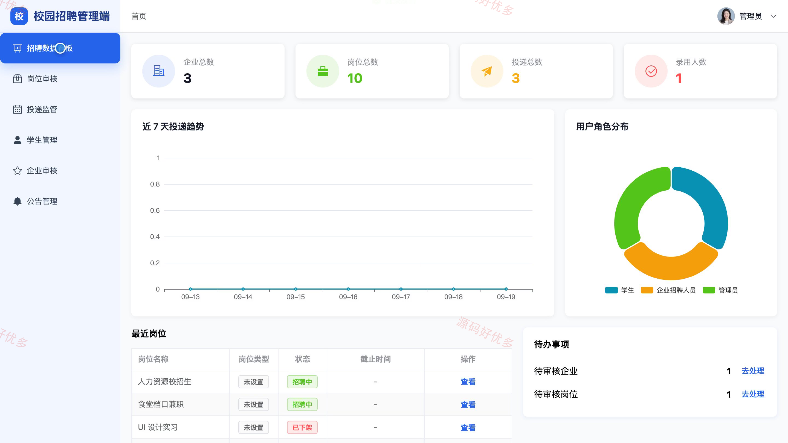
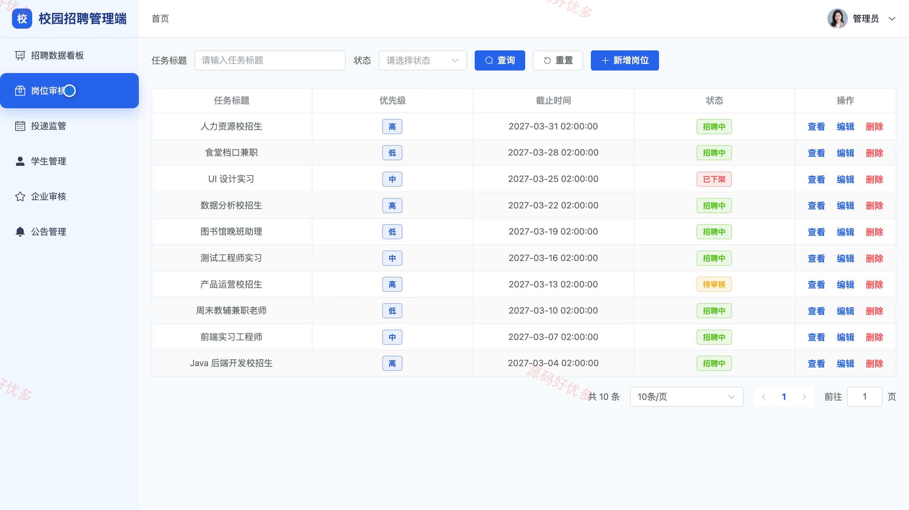
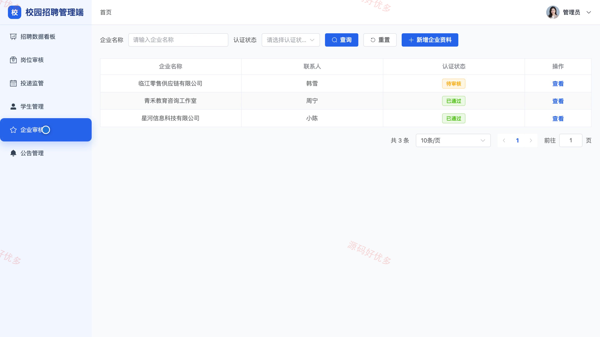

# bs125C
bs125C校园招聘兼职系统
## 源码问题查看主页咨询

### 一、关键词
校园招聘、大学生兼职、实习岗位、在线简历、招聘投递

### 二、作品包含
源码+数据库+万字设计文档+PPT+全套环境和工具资源+本地部署教程

### 三、项目技术
前端技术： Html、Css、Js、Vue3.4、Element-Plus
后端技术：Python、Django

### 四、运行环境要求
开发工具：PyCharm + VSCODE

数据库：MySQL5.7+（共10张表）

数据库管理工具：Navicat10以上版本

环境配置软件： Python3+

前端Nodejs：16+

浏览器：谷歌浏览器

### 五、项目介绍
项目编号：bs125C

本系统面向学生、企业招聘人员和管理员，提供校招及兼职岗位展示、在线简历、岗位投递、企业招聘处理和平台审核管理等功能。

角色：学生、企业招聘人员、管理员

学生功能：浏览并筛选校招与兼职岗位、查看岗位详情并收藏意向岗位、维护个人资料和在线简历、选择简历投递岗位并查看进度、查看面试通知与公告。

企业招聘人员功能：维护企业资料并查看认证状态、发布和管理校招及兼职岗位、查看岗位投递及候选人简历、处理投递并安排面试、查看招聘统计数据。

管理员功能：查看招聘数据看板、管理学生账号、审核企业资料、审核与管理招聘岗位、监管投递和面试记录、发布与维护平台公告。

### 六、运行截图

